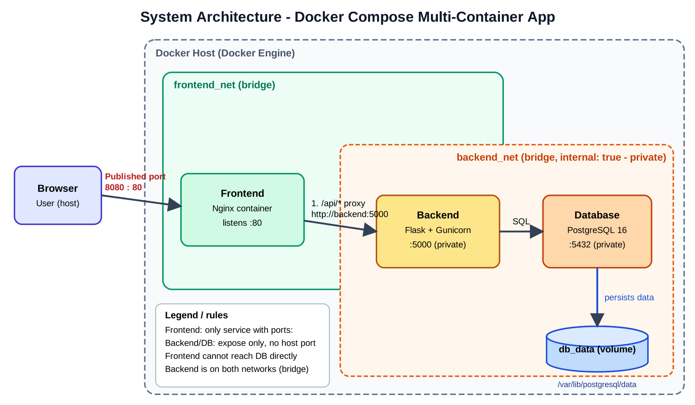

# Multi-Container App with Docker Compose

Nginx (frontend) + Flask (backend) + PostgreSQL (database), orchestrated with Docker Compose.
Only the frontend is reachable from the host.



## Run
```bash
cp .env.example .env     # set your own password
docker compose up -d --build
docker compose ps
```
Open http://localhost:8080

## Verify privacy
```bash
curl http://localhost:8080/api/health   # works (through Nginx proxy)
curl http://localhost:5000              # fails: backend not published
curl http://localhost:5432              # fails: database not published
docker compose exec frontend wget -qO- http://db:5432   # fails: frontend cannot see db (different network)
```

## Design explanation
- **Frontend (Nginx)** serves the static page and reverse-proxies `/api/*` to `backend:5000`. It is the only service with a `ports:` mapping (`8080:80`).
- **Backend (Flask/Gunicorn)** exposes `:5000` only inside Docker (`expose`, no host port). It talks to PostgreSQL by service name `db`.
- **Database (PostgreSQL 16)** exposes `:5432` only to `backend_net`. Data lives in the named volume `db_data`, so it survives `docker compose down` (removed only with `-v`).
- **Networks:** `frontend_net` connects frontend and backend. `backend_net` (`internal: true`) connects backend and database, so the frontend cannot reach the database and the database has no outside access. The backend sits on both networks and acts as the only bridge.
- **Reliability:** healthchecks plus `depends_on: condition: service_healthy` start services in order (db, backend, frontend).
- **Security:** secrets come from `.env` (git-ignored), backend runs as a non-root user.

## Screenshots
Place in `screenshots/`: `app.png` (running app) and `compose-ps.png` (`docker compose ps`).

## Flow
Browser -> `localhost:8080` -> Frontend -> `/api/*` -> Backend -> SQL -> Database -> `db_data` volume
